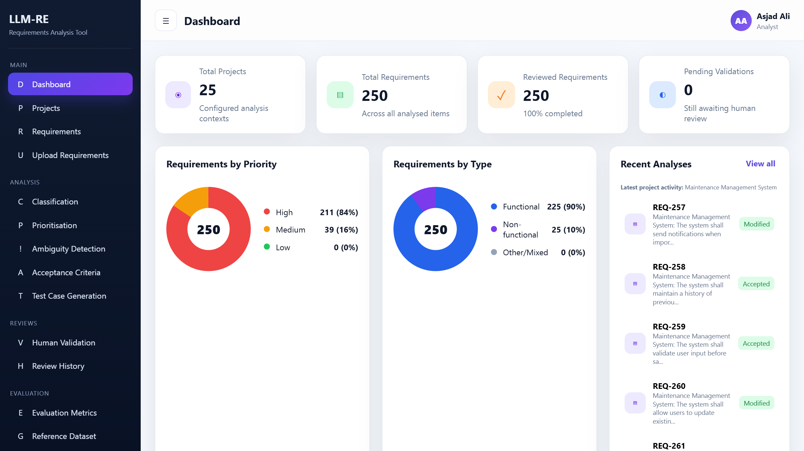
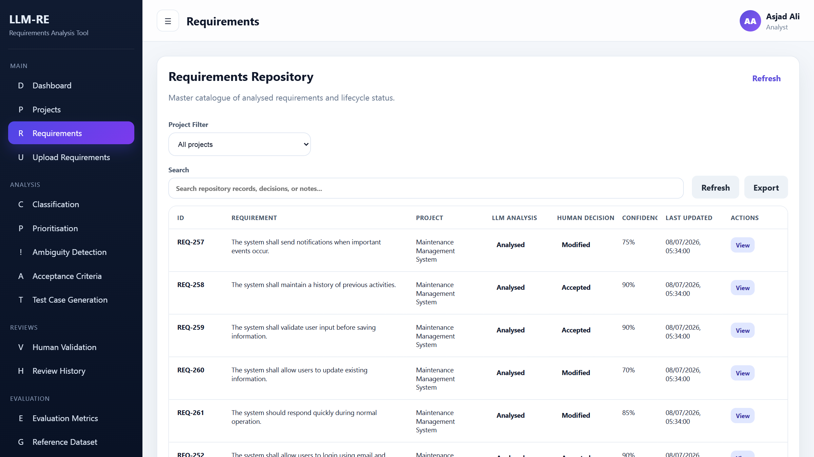
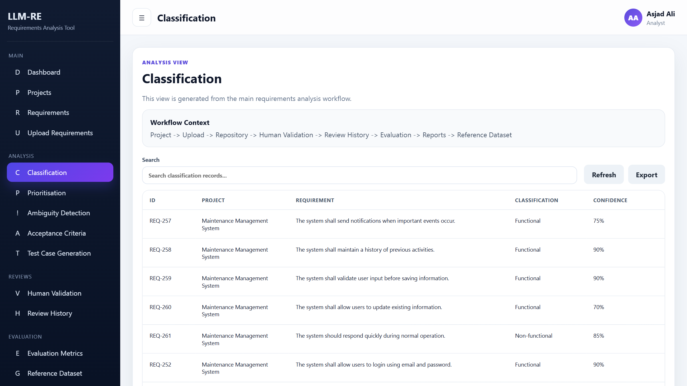
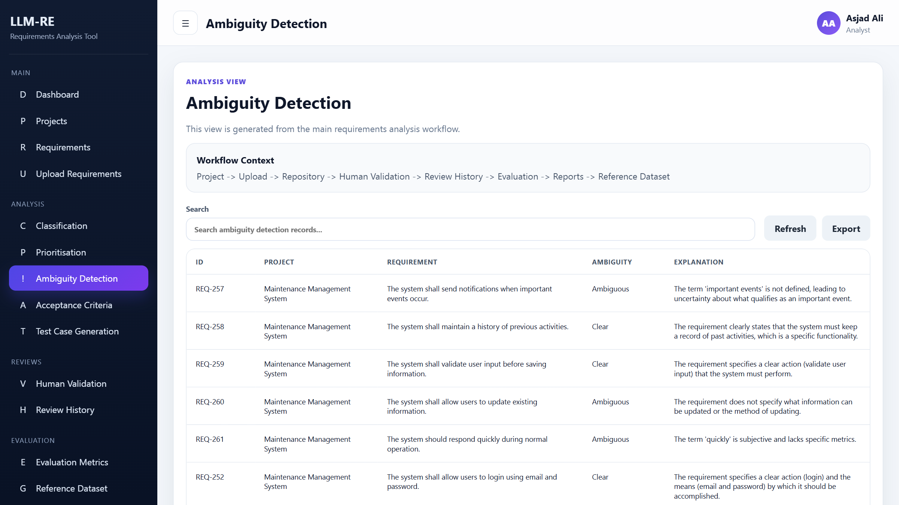
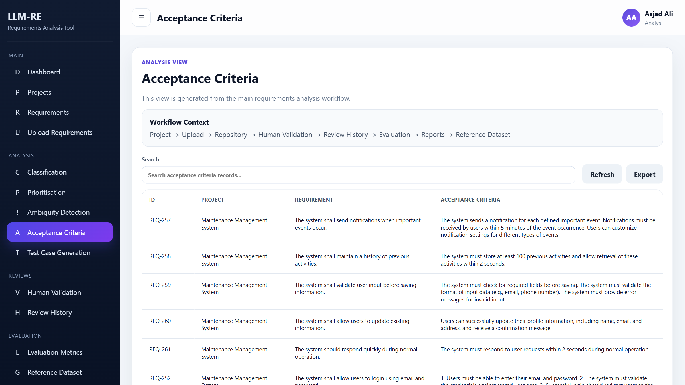
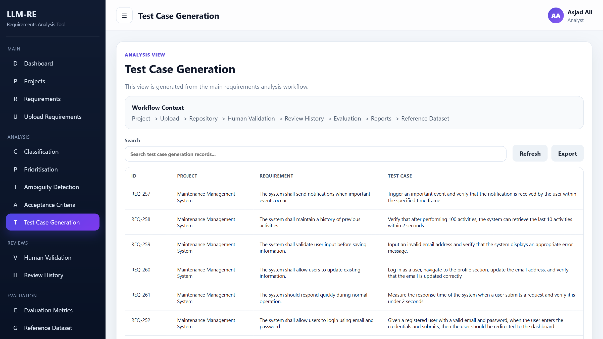
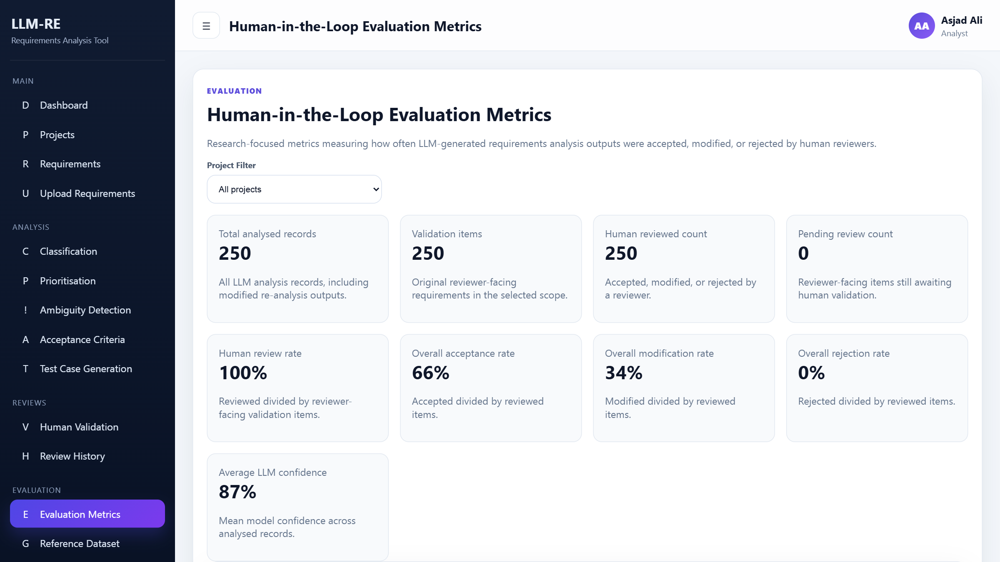
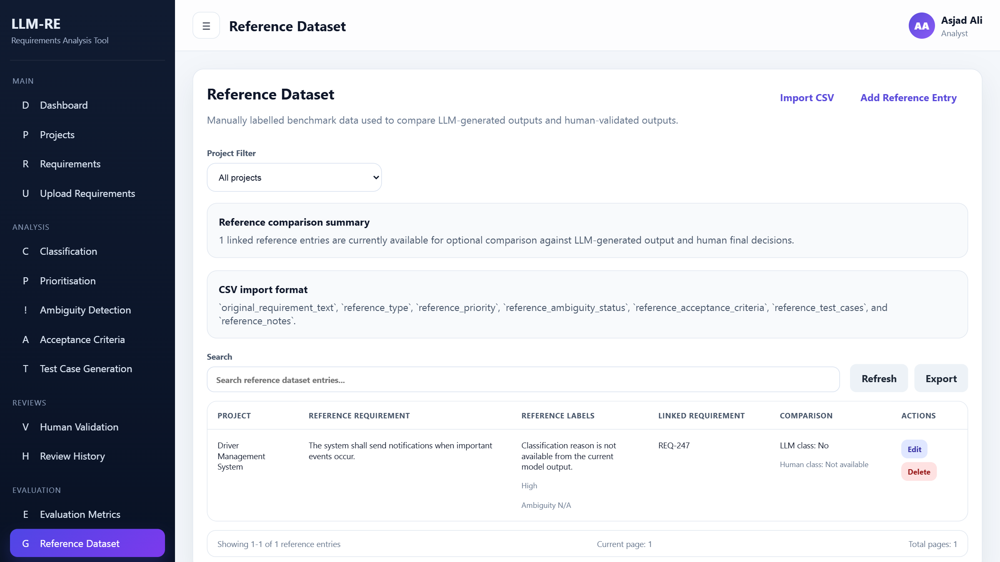
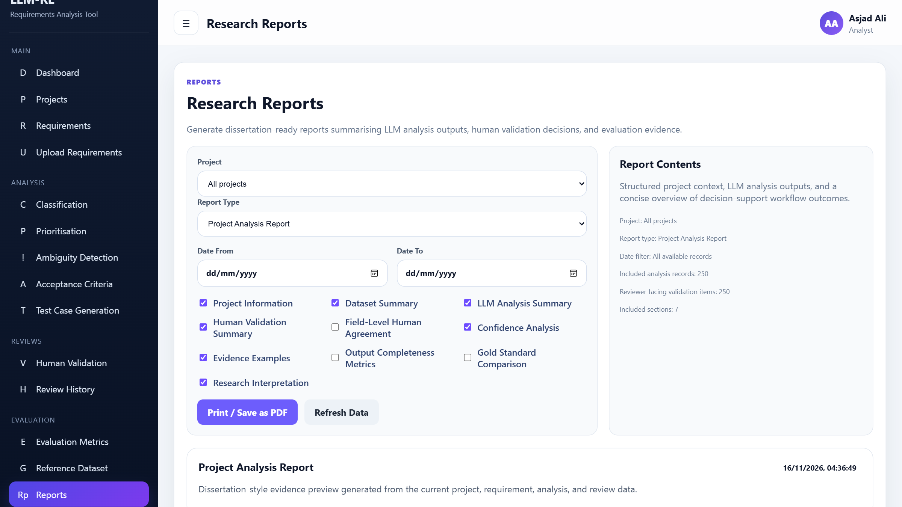

# LLM-Assisted Requirements Analysis Tool

An MSc Software Engineering research prototype for structured analysis of
natural-language software requirements. The application supports project-based
requirement input, PDF/DOCX extraction, requirement classification,
prioritisation, ambiguity identification, draft acceptance criteria and test
cases, review decisions, traceability, and evaluation reporting.

The tool is intended as decision support. Generated analysis should not be
treated as verified requirements-engineering evidence until it has been reviewed
by a human.

## About the Project

### The problem
Requirements engineering is slow and error-prone. Analysts read through large
sets of natural-language requirements and must decide, for each one, whether it
is functional or non-functional, how important it is, whether the wording is
ambiguous or untestable, and how it will be verified. Mistakes made at this
stage are expensive because they carry into design, implementation and testing.

### What this tool does
This tool uses a Large Language Model (LLM) to do the first pass of that
analysis, and keeps a human reviewer in control of the result. For every
requirement it produces:

| Output | Description |
|---|---|
| **Classification** | Functional vs. non-functional, with a confidence score |
| **Priority** | High / Medium / Low suggestion with reasoning |
| **Ambiguity check** | Highlights vague terms and explains why they are risky |
| **Acceptance criteria** | Draft, testable conditions for the requirement |
| **Test case** | A draft test case derived from the requirement |

A reviewer then **accepts, modifies or rejects** each output. Every decision is
stored, so the tool can report how often the LLM was right, how often it needed
correction, and how confident it was.

### Why it matters (research context)
The project was built for an MSc Software Engineering dissertation that asks:
*how useful and trustworthy is LLM output for requirements analysis when a human
stays in the loop?* The acceptance / modification / rejection rates recorded by
the tool are the evidence used to answer that question. The tool is decision
support, not an automatic replacement for a requirements engineer.

### How it works

```text
Requirement input (manual / PDF / DOCX)
        ↓
Extraction and pre-processing
        ↓
LLM analysis (OpenAI or offline mock provider)
        ↓
Structured result: class, priority, ambiguity, criteria, test case
        ↓
Human review: Accept / Modify / Reject
        ↓
SQLite storage → History → Evaluation metrics → Reports
```

### Architecture
Three layers:
1. **Presentation** – React + Vite single-page app (dashboard, repository,
   analysis views, validation, metrics, reports).
2. **Application** – FastAPI backend with routes for projects, analysis,
   history and the reference dataset, plus services for document extraction,
   prompt building and LLM calls.
3. **Data** – SQLite via SQLAlchemy.

The LLM layer is swappable: a deterministic **mock provider** lets anyone run
the whole system with no API key, and an **OpenAI provider** is enabled with
two environment variables.

### Evaluation data
The bundled database contains **25 synthetic projects and 250 requirements**
across different domains, all analysed and reviewed. In that dataset 66% of
outputs were accepted as-is and 34% were modified, with an average model
confidence of 87%. Review decisions were simulated by rule-based scripts, so
these figures demonstrate the metric pipeline and are **not** an independent
human study (see [Limitations](#limitations)).

### What this project demonstrates
Full-stack development (React, FastAPI, SQLAlchemy), LLM integration and prompt
design, document parsing (PDF/DOCX), human-in-the-loop system design, and
evaluation methodology for AI-assisted tooling.

---




---

## Key Features

- **Project-based workflow** – organise requirements per project, with manual entry or PDF/DOCX upload.
- **Automated analysis** – classification (functional / non-functional), prioritisation and confidence scoring.
- **Ambiguity detection** – flags vague or untestable wording in requirements.
- **Generated artefacts** – draft acceptance criteria and test cases for each requirement.
- **Human-in-the-loop review** – accept, modify or reject every LLM output, with full review history.
- **Evaluation metrics** – acceptance, modification and rejection rates, plus average model confidence.
- **Reference dataset and reports** – reproducible evaluation data and research-oriented reporting.
- **Pluggable LLM provider** – runs offline with a mock provider, or with OpenAI via a single setting.

---

## Screenshots

### Requirements Repository


### Classification


### Ambiguity Detection


### Acceptance Criteria


### Test Case Generation


### Human-in-the-Loop Evaluation Metrics


### Reference Dataset


### Research Reports


---

## Technology

- Frontend: React + Vite
- Backend: Python 3.11 + FastAPI + SQLAlchemy
- Database: SQLite
- LLM Support:
  - Mock provider (default)
  - OpenAI
- Document extraction:
  - pdfplumber
  - python-docx

Gemini integration is not implemented.

---

## Repository Structure

```text
backend/
│── app/            FastAPI application
│── data/           SQLite evaluation database
│── scripts/        Evaluation utilities
│── .env.example
│── requirements.txt

frontend/
│── src/
│── package.json

docs/
diagrams/
README.md
```

`backend/data/app.db` is intentionally included as dissertation evaluation
evidence.

The following are intentionally excluded by `.gitignore`:

- `.venv`
- `node_modules`
- `.env`
- build output
- logs
- temporary databases

---

# Prerequisites

Install the following before running the project:

- Python **3.11**
- Node.js **18+**
- npm
- Git (optional)

No OpenAI API key is required for the default mock mode.

---

# Quick Start (Windows)

Download or clone the repository.

Open two PowerShell windows.

---

## Backend Setup

Navigate to the backend folder:

```powershell
cd backend
```

Create a Python virtual environment:

```powershell
py -3.11 -m venv .venv
```

Activate the virtual environment:

```powershell
Set-ExecutionPolicy -Scope Process -ExecutionPolicy RemoteSigned
.\.venv\Scripts\Activate.ps1
```

Install dependencies:

```powershell
python -m pip install -r requirements.txt
```

Create the environment configuration:

```powershell
Copy-Item .env.example .env
```

Start the backend:

```powershell
python -m uvicorn app.main:app --reload
```

The backend will be available at:

```
http://127.0.0.1:8000
```

Swagger documentation:

```
http://127.0.0.1:8000/docs
```

---

## Frontend Setup

Open a second PowerShell window.

Navigate to the frontend folder:

```powershell
cd frontend
```

Install dependencies:

```powershell
npm install
```

Run the development server:

```powershell
npm run dev
```

The frontend will be available at:

```
http://localhost:5173
```

---

# Environment Configuration

The backend uses `backend/.env`.

Default configuration:

```env
USE_MOCK_LLM=true
LLM_PROVIDER=mock
OPENAI_API_KEY=
OPENAI_MODEL=gpt-4o-mini
DATABASE_URL=sqlite:///./data/app.db
```

This configuration works immediately without any API key.

To use OpenAI instead:

```env
USE_MOCK_LLM=false
LLM_PROVIDER=openai
OPENAI_API_KEY=your-api-key
OPENAI_MODEL=gpt-4o-mini
```

---

# Application Workflow

```text
Project
    ↓
Manual Entry / PDF / DOCX
    ↓
Requirement Extraction
    ↓
LLM Analysis
(Mock or OpenAI)
    ↓
Review Decision
(Accept / Modify / Reject)
    ↓
History
    ↓
Evaluation
    ↓
Reports
```

---

# Evaluation Utilities

Run these only when reproducing the dissertation evaluation.

From the backend directory:

```powershell
python scripts/seed_large_evaluation_dataset.py
python scripts/run_large_scale_analysis.py
python scripts/auto_validate_results.py
python scripts/generate_domain_evaluation_summary.py
```

Purpose:

- **seed_large_evaluation_dataset.py**
  Creates the synthetic evaluation dataset.

- **run_large_scale_analysis.py**
  Runs analysis for requirements without stored results.

- **auto_validate_results.py**
  Generates rule-based simulated review decisions for evaluation metrics.

- **generate_domain_evaluation_summary.py**
  Produces a read-only summary of stored evaluation data.

> These scripts are **not required** to start or use the application.

> Do **not** execute them against the tracked evaluation database unless regeneration is intentional.

---

# Main API Endpoints

- `/`
- `/health`
- `/docs`
- `/api/projects`
- `/api/analysis`
- `/api/history`
- `/api/reference-dataset`

---

# Limitations

This project is a research prototype rather than a production
requirements-management platform.

Current limitations include:

- SQLite instead of an enterprise database
- No automated test suite
- No migration framework
- No authentication
- No role-based access control
- No multi-reviewer workflow
- No concurrency testing
- No penetration testing
- No load testing
- Synthetic evaluation dataset
- Simulated review decisions
- LLM output may vary between model versions
- Confidence scores should not be interpreted as calibrated prediction accuracy

The included evaluation demonstrates the implemented workflow and metric
pipeline but does not constitute industrial-scale validation or independent
human evaluation of every analysed requirement.

---

# License

This repository accompanies an MSc Software Engineering dissertation and is
provided for academic and research purposes.